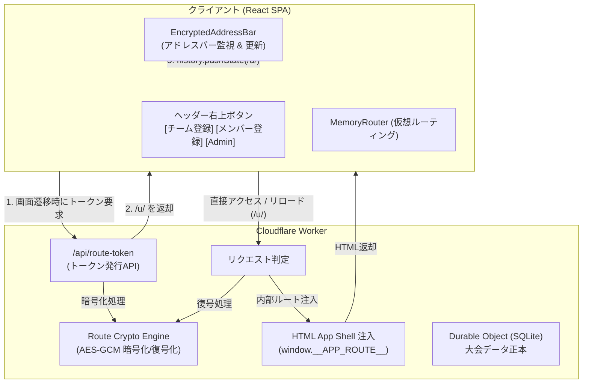

# 基本・詳細設計書: URL暗号化 & ヘッダーナビゲーション拡張

- **文書バージョン**: 1.0.0
- **対象システム**: VELOCITY CUP 2026 大会運営Webアプリ
- **作成日**: 2026-10-27

---

## 1. 目的と概要

### 1.1 背景
- **URL構造の隠蔽と簡潔化**: URLに大会開催日（`/20261220/`）や内部パス（`/matches`, `/admin` 等）が平文で露出している状態を改め、アドレスバー上を暗号化トークン（`/u/<token>`）に変換して表示したい。
- **代表者・参加者の導線改善**: 大会トップ（Desktop View）の右上に「Admin」ボタンのみが存在しているが、大会参加者や代表者が迷わずアクセスできるよう「チーム登録」「メンバー登録」への直接リンクボタンを常時配置したい。

### 1.2 達成目標
1. ユーザーがブラウザでページを開いた際、URLのアドレスバーが **`https://<domain>/u/<暗号化トークン>`** として表示されること。
2. 暗号化URLを開き直したり再読み込み（リロード）した場合でも、元の画面が正確に復元されて表示されること。
3. デスクトップ表示のヘッダー右側に **「チーム登録」**・**「メンバー登録」**・**「Admin」** の3ボタンがスマートに並び、本番環境でも正しく機能すること。

---

## 2. システム構成と変更方針



---

## 3. 機能詳細設計

### 3.1 URL暗号化（URL Encryption）

#### 3.1.1 暗号化アルゴリズム仕様
- **方式**: Web Crypto API `AES-GCM` (256-bit)
- **暗号鍵（Key）**: Cloudflare Secrets の `SESSION_SECRET` を SHA-256 でハッシュ化して生成。
- **IV (初期化ベクトル)**: 12バイトの暗号論的疑似乱数（`crypto.getRandomValues`）。暗号化ごとにユニーク生成。
- **トークン形式**: `[IV (12 bytes)] + [Ciphertext + AuthTag (16 bytes)]` を Base64URL 形式に変換。
- **URLプレフィックス**: `/u/`
  - 例: `https://velocity-cup.workers.dev/u/mK8w_9xQe12...`

#### 3.1.2 サーバー側（Cloudflare Worker）の動作
1. **暗号化ルートへのアクセス（`/u/:token`）**:
   - `token` を復号して内部ルート文字列（例: `/20261220/matches`）を取り出す。
   - 不正なトークンまたは無効なルートの場合は `404 Not Found` を返す。
   - 有効な場合、静的HTMLシェルを取得し、`<head>` 内に以下を安全に注入してレスポンスする。
     ```html
     <script>window.__APP_ROUTE__ = "/20261220/matches";</script>
     ```
2. **平文の公開ルートへの初回アクセス（例: `/`, `/20261220/matches` 等）**:
   - 該当パスを暗号化し、対応する `/u/<token>` へ **302 Redirect** する。
3. **API・アセットリクエスト（除外対象）**:
   - `/api/*`, `/assets/*`, 静的画像（`.png` 等）は暗号化を行わず、通常のルーティング・API処理を行う。
4. **トークン生成API（`POST /api/route-token`）**:
   - Body: `{"route": "/20261220/teams"}`
   - Response: `{"url": "/u/<base64url_token>"}`
   - クライアントがSPA内部で画面遷移する際に利用する。

#### 3.1.3 クライアント側（React）の動作
1. **エントリーポイント（`main.tsx`）**:
   - `window.__APP_ROUTE__` が存在する場合はそれを初期URLとして採用。
   - ルーティングは `BrowserRouter` から **`MemoryRouter`** に切り替え、内部パスとアドレスバーの物理URLを分離する。
2. **アドレスバー同期コンポーネント（`EncryptedAddressBar`）**:
   - 画面遷移が発生するたびに `useLocation()` でルートを検知。
   - `POST /api/route-token` から暗号化URLを取得し、`history.pushState()` / `replaceState()` でアドレスバーを更新。
   - ブラウザの「戻る」「進む」（`popstate`）操作にも対応し、内部履歴とアドレスバーを完全同期。

---

### 3.2 ヘッダーナビゲーション拡張（Desktop View）

#### 3.2.1 ボタン配置と遷移先
ヘッダー（`topbar`）の右側エリアに、以下の3つのボタングループを配置します。

| ボタン表示名 | アイコン/装飾 | 内部遷移先 | 役割 |
|---|:---:|---|---|
| **チーム登録** | 📝 | `/registration/20261220/` | クラブ・参加チームの新規登録フォームを開く |
| **メンバー登録** | 👥 | `/registration/20261220/verify` | 代表者の本人確認を行い、選手名・背番号を登録する |
| **Admin** | 🔒 ↗ | `/admin`（`/20261220/admin`） | Super Admin / SubAdmin ログイン画面を開く |

#### 3.2.2 レイアウト & デザイン仕様
- **配置**: ヘッダー右端（ロゴ・大会タイトルと対向する位置）
- **環境設定**: 以前の `import.meta.env.DEV` の限定を解除し、**本番環境でも常時利用可能** に変更。
- **ボタンスタイル**:
  - `チーム登録`: プライマリー強調（アクセントカラー/視認性を高めた配色）
  - `メンバー登録`: セカンダリー（枠線付きボタン）
  - `Admin`: 管理用アイコン付きリンク（控えめな半透明/ゴーストボタン）
- **レスポンシブ動作**:
  - **Desktop (幅 >= 768px)**: 3ボタンを横並びで表示。
  - **Mobile (幅 < 768px)**: ヘッダーが圧迫されないよう、アイコン化またはサイドメニュー/ハンバーガー内に収容。

---

## 4. 変更対象ファイル一覧

| ファイルパス | 変更区分 | 主な変更内容 |
|---|:---:|---|
| `worker/route-token.ts` | 新規作成 | AES-GCM によるルート暗号化・復号化ロジック |
| `worker/index.ts` | 修正 | `/u/*` の復号とHTML注入、平文URLの302転送、`/api/route-token` API追加 |
| `wrangler.jsonc` | 修正 | `run_worker_first` に `/u/*` と `/` を追加 |
| `src/components/ui/EncryptedAddressBar.tsx` | 新規作成 | アドレスバーのURL暗号化・履歴同期コンポーネント |
| `src/main.tsx` | 修正 | `MemoryRouter` への移行、`__APP_ROUTE__` の注入読み込み |
| `src/App.tsx` | 修正 | ヘッダー右側に「チーム登録」「メンバー登録」「Admin」ボタンを配置 |
| `src/styles.css` | 修正 | ヘッダーボタングループのスタイリング（デスクトップ/モバイル対応） |
| `worker/api.test.ts` | 修正 | 暗号化ルート・リダイレクト・HTML注入のテストケース追加 |

---

## 5. テスト・検証計画

1. **暗号化エンジン単体テスト**:
   - ルート暗号化 → 復号化で元の文字列と一致すること。
   - 不正なIVや改ざんされたトークンで `null` が返ること。
2. **Worker 統合テスト**:
   - `/` や `/20261220/matches` にアクセスした際、`/u/<token>` へリダイレクト（302）されること。
   - `/u/<token>` にアクセスした際、`window.__APP_ROUTE__` が埋め込まれた 200 HTML が返ること。
   - `/api/route-token` が正しいトークンを返すこと。
3. **UI・ブラウザ挙動テスト**:
   - デスクトップ表示で右上に3つのボタンが表示されていること。
   - 各ボタンクリックで対応する画面へスムーズに遷移すること。
   - 画面遷移時にアドレスバーが `/u/...` の暗号化形式に更新されること。
   - ページをリロードしても元の画面が正常に維持されること。
   - `npm test`, `npm run typecheck`, `npm run lint` がすべてパスすること。
