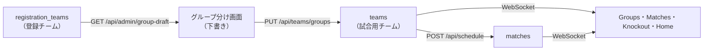

# 設計書: 管理画面のグループ分け（ドラッグ＆ドロップ）

- **文書バージョン**: 0.1.0（レビュー待ち）
- **作成日**: 2026-11-07
- **関連文書**: `docs/グループ分け_仕様書.md`（何を作るか）

---

## 1. 全体の方針

- 外部ライブラリは増やさない。ドラッグ＆ドロップは **Pointer Events** で自作する（マウスと指の両方で同じコードが動く。HTML5 の drag and drop は iPad で動かないため使わない）。
- グループ分けの「下書き」は画面だけで持ち、「Save groups」で1回の API にまとめて送る。
- 試合用チームの表（`teams`）に、元の登録チームの ID を持たせる。



## 2. データ（Durable Object の SQLite）

### 2.1 `teams` に列を追加

```sql
ALTER TABLE teams ADD COLUMN registration_team_id TEXT;
```

- 既存のDBには `store_migrations` に `teams-registration-team-id` を記録して、一度だけ実行する。
- `Team` 型に `registrationTeamId?: string | null` を追加する。
- 試合用チームの `id` は、登録チームの `id` をそのまま使う（保存し直しても同じ ID になり、マイチームの保存が消えない）。
- `logo_id` には、登録チームのクラブのロゴ（`registration_clubs.logo_id`）を入れる。ロゴは同じ `logos` 表にあるので、コピーはいらない。
- `color` は、グループごとの位置で決める（8色の表から）。

## 3. API（すべて Super Admin 専用、変更系は `content-type: application/json`）

| メソッド | パス | 用途 |
|---|---|---|
| `GET` | `/api/admin/group-draft` | 登録チームの一覧（id、チーム名、クラブ名、ロゴID）と、今保存されているグループ分け（`{ A: [登録チームID...], ... }`）、試合が始まっているか |
| `PUT` | `/api/teams/groups` | グループ分けを保存する。本文: `{ "groups": { "A": ["<登録チームID>", ...], ..., "H": [...] } }` |
| `POST` | `/api/schedule` | 今と同じ。チーム数のチェックを新しいルールに変える |
| `POST` | `/api/initialize` | 今と同じ |

### 3.1 `PUT /api/teams/groups` のチェック

| チェック | エラー |
|---|---|
| 本文の形が正しい（キーは A〜H だけ、値は文字列の配列） | `400 INVALID_GROUPS` |
| 1グループ5チーム以下 | `400 GROUP_TOO_LARGE` |
| 同じチームが2回出てこない | `400 DUPLICATE_TEAM` |
| すべて存在する登録チーム | `400 UNKNOWN_REGISTRATION_TEAM` |
| 試合が始まっていない | `409 TEAM_IN_USE`（今と同じ） |

- 通ったら、1つのトランザクションで `matches` と `teams` を消し、登録チームの名前・ロゴで `teams` を作り直し、`version` を上げる。WebSocket で配信する。

### 3.2 `POST /api/schedule` の新しいチェック

- 今: 40チームで各グループ5チーム。
- 新: 8グループそれぞれ **2〜5チーム**。満たさないときは `400 INVALID_TEAM` で、足りないグループを `error` に書く。
- 試合の作り方（`buildTournamentSchedule`）は、もともとグループの人数に関係なく総当たりを作るので、そのまま使う。チーム数が少なくてもコートの重複がないことをテストで確かめる。

### 3.3 登録チームの削除

- `DELETE /api/admin/registrations/teams/:teamId` で、そのチームが `teams.registration_team_id` にあるときは `409 TEAM_IN_GROUP` を返して削除しない。
- 登録チームの名前を変えても、`teams` は自動では変えない（次の保存で反映）。

## 4. 画面

### 4.1 ファイル

| ファイル | 内容 |
|---|---|
| `src/features/admin/grouping/GroupBoard.tsx`（新規） | 画面全体。下書きの状態、ボタン、保存 |
| `src/features/admin/grouping/TeamChip.tsx`（新規） | ロゴとチーム名のカード。ドラッグ・タップの元 |
| `src/features/admin/grouping/DropZone.tsx`（新規） | 未割り当て欄と8グループの枠 |
| `src/features/admin/grouping/useDragAndDrop.ts`（新規） | Pointer Events のドラッグ |
| `src/features/admin/grouping/draft.ts`（新規） | 下書きの計算（動かす、数える、ルールのチェック）。React を使わない純粋な関数にしてテストする |
| `src/pages/TeamManager.tsx` | 削除（`GroupBoard` に置き換え） |
| `src/pages/AdminSetup.tsx` | `TeamManager` の代わりに `GroupBoard` を出す |
| `worker/store.ts`、`worker/api.ts`、`worker/registration.ts`、`src/types/index.ts` | 2・3章のとおり |

### 4.2 下書き（`draft.ts`）

```ts
type GroupId = "A" | "B" | "C" | "D" | "E" | "F" | "G" | "H";
type Draft = Record<GroupId, string[]>; // 登録チームIDの並び
const UNASSIGNED = "unassigned";

moveTeam(draft, teamId, to: GroupId | typeof UNASSIGNED): Draft  // 5チームを超えるときは動かさない
unassignedTeams(draft, registeredTeams): RegisteredTeam[]
scheduleProblems(draft): string[]   // 例: ["Group H needs at least 2 teams"]。空なら試合を作れる
isDirty(draft, saved): boolean
```

### 4.3 ドラッグ（`useDragAndDrop.ts`）

1. カードで `pointerdown` → `setPointerCapture`。5px 以上動いたらドラッグ開始（それより小さければタップとして扱う）。
2. ドラッグ中はカードの影を指・マウスについてこさせる（`position: fixed`、`transform`）。
3. `pointermove` のたびに `document.elementFromPoint` で下にある枠（`data-drop-zone="A"` など）を探し、枠を光らせる。満員の枠は赤くする。
4. `pointerup` で枠の上なら `moveTeam`。枠の外なら何もしない。
5. カードに `touch-action: none` を付け、iPad でドラッグ中に画面がスクロールしないようにする。画面の端に近づいたら少しずつスクロールする。

### 4.4 タップで動かす

- カードをタップすると「選択中」になる（枠線をオレンジに）。次に枠をタップすると、そこへ動かす。
- キーボードでも使えるように、カードと枠は `button` にする（Enter・Space で同じ動き）。

### 4.5 保存とページ離脱

- 「Save groups」は `PUT /api/teams/groups`。成功したら `GET /api/admin/group-draft` を読み直して下書きを保存済みにする。
- 試合があるときは保存前に `window.confirm` で確認する。
- 下書きに変更があるときは `beforeunload` で確認する。

## 5. テスト

| 種類 | 内容 |
|---|---|
| `draft.test.ts` | 動かす・外す・5チームを超えない・ルールのチェック・変更ありの判定 |
| `worker/api.test.ts` | `PUT /api/teams/groups` の権限・チェック・保存後の state（名前・ロゴ・ID）、試合開始後の 409、`POST /api/schedule` が 2〜5チームのグループで動く・1チームのグループでは 400、グループに入っている登録チームの削除が 409、`GET /api/admin/group-draft` |
| `schedule.test.ts` | 16・24・33チームなどでコートの重複がない、各グループの総当たりがそろう |
| 手動（ブラウザ） | PC のマウスと iPad（タッチ）でドラッグ・タップ、保存、Generate、Groups 画面への反映、ロゴの表示 |

## 6. リスク

| リスク | 対策 |
|---|---|
| iPad でドラッグ中に画面がスクロールする | `touch-action: none` と、端での自動スクロール |
| 保存し忘れ | 「Unsaved changes」の表示と、ページ離脱の確認 |
| 試合のあとでグループを変えて順位がおかしくなる | 試合開始後は保存できない（今と同じ） |
| 登録チームを消して試合のチームがなくなる | グループに入っている登録チームは削除できない |
