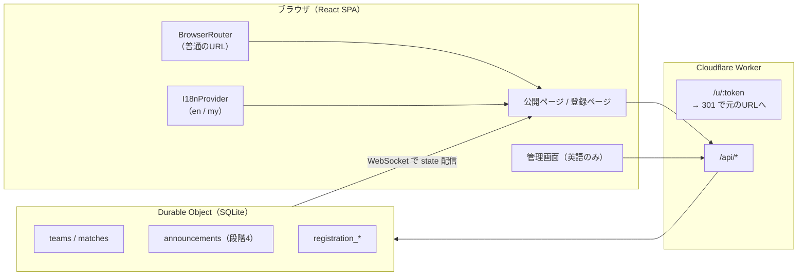

# 基本・詳細設計書: サイト改善・多言語化（英語・ミャンマー語）

- **文書バージョン**: 0.2.0（2026-11-03 決定事項を反映）
- **対象システム**: VELOCITY CUP 2026 大会運営Webアプリ
- **作成日**: 2026-11-02
- **関連文書**: `docs/サイト改善_仕様書.md`（何を作るか）、`docs/仕様書.md`（全体の仕様）

この設計書は「どう作るか」を書く。画面の動きや決まりは仕様書を正とする。各段階の実装が終わったら、`docs/仕様書.md` の該当する章も更新する。

---

## 1. 全体の方針

- 外部ライブラリは増やさない（多言語化も自作の小さな仕組みにする）。
- 1段階ごとに「実装 → テスト → コミット → ココさんの確認」を行う。
- 既存のテスト（146件）をすべて通したまま進める。
- サーバーの変更は Worker（`worker/`）と Durable Object の SQLite に閉じる。



---

## 1A. テスト環境（段階1の前に作る）

### 1A.1 構成

| 項目 | 本番 | テスト |
|---|---|---|
| Worker 名 | `velocity-cup` | `velocity-cup-staging` |
| URL | `velocity-cup.komyat-8mk.workers.dev` | `velocity-cup-staging.komyat-8mk.workers.dev` |
| Durable Object | 本番用 | テスト用（別のデータ） |
| `APP_ENV` | `production` | `staging` |
| `REGISTRATION_LIMITS` | `on` | `off`（締め切り・定員のチェックをしない） |
| `/test/` | 404 | 開ける |
| Secret（パスワード等） | 本番用 | テスト用（別の値） |

### 1A.2 `wrangler.jsonc`

```jsonc
{
  "name": "velocity-cup",
  "vars": { "APP_ENV": "production", "REGISTRATION_LIMITS": "on" },
  // ...今の設定...
  "env": {
    "staging": {
      "name": "velocity-cup-staging",
      "vars": { "APP_ENV": "staging", "REGISTRATION_LIMITS": "off" },
      "durable_objects": {
        "bindings": [{ "name": "TOURNAMENT", "class_name": "TournamentRoom" }]
      }
    }
  }
}
```

- `vars` と `durable_objects` は env ごとに書き直す必要がある（wrangler の決まり）。
- Secret は `npx wrangler secret put SUPERADMIN_PASSWORD --env staging` のように env を付けて別に登録する（`SUBADMIN_PASSWORD`、`SESSION_SECRET` も）。
- `npm run cf-typegen` で `Env` 型に `APP_ENV` と `REGISTRATION_LIMITS` を加える。

### 1A.3 ビルドとデプロイ

`package.json`:

```json
"deploy:staging": "cross-env CLOUDFLARE_ENV=staging npm run build -- --mode staging && node scripts/clean-appledouble.mjs && wrangler deploy"
```

- `@cloudflare/vite-plugin` はビルド時の `CLOUDFLARE_ENV` で env を選ぶ。Windows でも動くように `cross-env`（開発用）を追加する。
- 実装時に、生成された `dist` の wrangler 設定が `velocity-cup-staging` になっていることを確認する。

### 1A.4 Worker と画面の変更

| ファイル | 変更 |
|---|---|
| `worker/index.ts` | `APP_ENV === "production"` のとき `/test`、`/test/*` を404。`ALLOWED_TOURNAMENT_IDS` から `test` を外す |
| `worker/index.ts` | `GET /api/env` を追加（公開。`{ "environment": "production" \| "staging" }`） |
| `wrangler.jsonc` | 本番で `/test/*` を Worker が先に処理するよう、`run_worker_first` の `!/test`、`!/test/*` を外す |
| `src/components/ui/TestSiteBanner.tsx`（新規） | `/api/env` が `staging` のとき、画面の一番上に帯を表示 |
| `worker/registration.ts` | `REGISTRATION_LIMITS === "off"` のとき、締め切りと定員のチェックをしない |

**テスト**: 本番設定で `/test/` が404、`x-tournament-id: test` が400。テスト設定では両方使える。

---

## 2. 段階1: 整理と使いやすさ

### 2.1 URL暗号化の廃止

**クライアント**

| ファイル | 変更 |
|---|---|
| `src/main.tsx` | `MemoryRouter` を `BrowserRouter`（`basename` は今と同じ）に戻す。`__APP_ROUTE__` は読まない。`setTournamentId()` は残す |
| `src/components/ui/EncryptedAddressBar.tsx` | 削除 |
| `src/config.ts` | `/u/` の分岐は残す（古いURLが一瞬表示されても安全なため） |

**Worker（`worker/index.ts`）**

```text
GET /u/<token>
  ├─ 復号できる かつ 公開ルート → 301 Location: <復号したルート>
  └─ それ以外                   → 404
GET / → 302 Location: /20261220/
POST /api/route-token → 削除（404 になる）
```

- 平文の公開URLを `/u/` へ転送する処理は削除する。
- `worker/route-token.ts` は `decryptRoute` と `isPublicRoute` だけ残し、`encryptRoute` はテスト用に残すか削除する。
- `wrangler.jsonc` の `run_worker_first` は `/u/*` を残す（古いリンクのため）。

**テスト**: `worker/api.test.ts` の暗号化テストを「`/u/<token>` が 301 で元のURLへ戻る」「壊れたトークンは404」に書き換える。

### 2.2 メニューとルート

`src/App.tsx` の `navItems` を次にする。ラベルは段階2で翻訳キーに変える。

| to | ラベル | 備考 |
|---|---|---|
| `/` | Home | |
| `/matches` | Matches | |
| `/groups` | Groups | 順位表＋試合 |
| `/knockout` | Knockout | |
| `/info` | Info | 段階3まで `/teams`（ラベル Teams） |

- PCの左メニュー（`.sidebar`）は Teams と Live も表示する（全7〜8項目）。下メニュー（`.bottom-nav`）だけ5項目にする。そのため `navItems` に `mobile: boolean` を持たせる。
- ルート変更: `/standings` → `<Navigate to="/groups" replace />`。

### 2.3 Groups と Standings の統合

| ファイル | 変更 |
|---|---|
| `src/features/tournament/components/StandingsTable.tsx`（新規） | `Standings.tsx` から1グループ分の表を切り出す。`compact` のときは Played・Goal diff.・Points だけ |
| `src/pages/Groups.tsx` | 一覧: 全グループの `StandingsTable`。詳細（`GroupDetail`）: 表＋そのグループの試合 |
| `src/pages/Standings.tsx` | 削除 |

- `Standings.tsx` が `initialTeams`（サンプル）を使っている所は使わない。チームが0件なら 3.5 の案内を出す。

### 2.4 ヘッダー

`src/App.tsx` の `.topbar`:

```text
[ロゴ] VELOCITY CUP 2026          [EN|မြန်မာ] [Register]
```

- Admin の `NavLink` を外す。チーム登録・メンバー登録の2つは `Register` 1つにまとめる。
- CSS（`src/styles.css`）:
  - `.brand` に `min-width: 0; overflow: hidden; text-overflow: ellipsis; white-space: nowrap;`
  - ボタンは `min-height: 44px; white-space: nowrap;`
  - 375px 以下ではタイトルの文字を小さくする（`@media (max-width: 420px)`）。

### 2.5 空ページの案内

既存の `src/components/ui/Empty.tsx` を使い、各ページで件数0のときに案内文を出す。文言は段階2で翻訳キーにする。

### 2.6 レビューの残り

| 項目 | 方法 |
|---|---|
| ヘッダーロゴ | `public/velocity-fc-logo.png`（768px）から 128px の `velocity-fc-logo.webp` を作り、`` は `width`/`height` を指定 |
| クラブロゴ | Worker では画像を縮小できないので、**アップロード前にブラウザで縮小** する（`canvas` で最大 256px、WebP、品質0.85）。既存の大きいロゴは表示サイズをCSSで固定し、必要なら Super Admin が再アップロード |
| Admin ログイン | `LoginForm.tsx` のプレースホルダーを削除し、`<label>Username</label>` `<label>Password</label>` を付ける |
| セキュリティヘッダー | HTMLは `public/_headers`（Workers Static Assets の機能）、APIは `worker/http.ts` の `jsonResponse` で付ける |
| 英語の表現 | レビュー書 3.4 の表のとおり直す（段階2で翻訳ファイルに入れる） |

`public/_headers` の内容（案）:

```text
/*
  X-Content-Type-Options: nosniff
  Referrer-Policy: strict-origin-when-cross-origin
  X-Frame-Options: DENY
  Content-Security-Policy: default-src 'self'; img-src 'self' data: blob:; style-src 'self' 'unsafe-inline' https://fonts.googleapis.com; font-src https://fonts.gstatic.com; connect-src 'self'; frame-ancestors 'none'; base-uri 'self'; form-action 'self'
```

- URL暗号化をやめると `<script>window.__APP_ROUTE__=...</script>` の埋め込みがなくなるので、`script-src` に `'unsafe-inline'` はいらない。
- `style-src 'unsafe-inline'` は React の `style` 属性のため。

---

## 3. 段階2: 多言語化

### 3.1 ファイル構成

```text
src/i18n/
  messages.ts      … 翻訳の文（英語とミャンマー語を並べて書く）← ココさんが確認するファイル
  I18nProvider.tsx … 言語の状態、切り替え、保存
  useI18n.ts       … t()、formatDate()、formatTime() を返すフック
  errors.ts        … サーバーのエラーコード → 翻訳キー
  i18n.test.ts
src/components/ui/LanguageSwitch.tsx
```

### 3.2 翻訳ファイルの形

確認しやすいように、1つのキーに英語とミャンマー語を並べる。

```ts
export const messages = {
  "nav.home": { en: "Home", my: "ပင်မ" },
  "home.countdown.title": { en: "Countdown to kick-off", my: "..." },
  "teams.registered": { en: "{count} teams registered", my: "..." },
  // ...
} as const satisfies Record<string, { en: string; my?: string }>;

export type MessageKey = keyof typeof messages;
```

- `{count}` のような部分は、プログラムが値を入れる。訳すときも `{count}` はそのまま残す。
- `my` がない、または空のときは `en` を表示する。
- テストで「全部のキーに `en` がある」「`my` の `{...}` が `en` と同じ」ことを確認する。

### 3.3 言語の状態

| 項目 | 内容 |
|---|---|
| 初期値 | `en` |
| 保存 | `localStorage` のキー `vc.lang`（読めないときは `en`。`try/catch` で囲む） |
| `<html lang>` | 切り替えのたびに `document.documentElement.lang` を `en` / `my` にする |
| 範囲 | `main.tsx` で `App` と `RegistrationApp` の両方を `I18nProvider` で包む |

管理画面のコンポーネント（`pages/SuperAdmin.tsx`、`SubAdmin.tsx`、`AdminRegistrations.tsx`、`TeamManager.tsx`、`AdminSetup.tsx`、`features/admin/*`）は `t()` を使わず、英語のままにする。

### 3.4 日付・時刻・数字

- `Intl.DateTimeFormat` を使う。ロケールは `en-GB` と `my-MM-u-nu-latn`。
- ミャンマー語でも **数字はアラビア数字（0〜9）** にする（スコアや時刻を読みやすくするため）。ミャンマー数字にしたい場合は `-u-nu-latn` を外すだけでよい。
- 時刻は日本時間（`Asia/Tokyo`）で表示する。今の `utils/format.ts` を `useI18n()` 経由で呼ぶ形に変える。

### 3.5 フォント

- Google Fonts の **Noto Sans Myanmar** を追加する。
- `:lang(my) body { font-family: "Noto Sans Myanmar", "Space Grotesk", sans-serif; line-height: 1.8; }`
- ミャンマー文字は縦に高いので、ボタンや見出しの高さ・行間を `:lang(my)` で調整する。英語の大文字だけの装飾（`text-transform: uppercase`、`letter-spacing`）はミャンマー語では外す。

### 3.6 サーバーのエラー

- サーバーは今までどおり英語の `error` と `code` を返す（変更なし）。
- 画面では `code` から翻訳キーを選ぶ（`src/i18n/errors.ts`）。対応表にない `code` は共通の文（「Something went wrong. Please try again.」）を出す。
- 対象: 登録（`INVALID_EMAIL`、`INVALID_PHONE`、`TOO_MANY_ATTEMPTS`、`DUPLICATE_TEAM_NAME` など、`worker/registration.ts` の全コード）。

---

## 4. 段階3: 大会情報と登録状況

### 4.1 大会情報ページ

| ファイル | 内容 |
|---|---|
| `src/content/info.ts`（新規） | 大会情報の中身。言語ごとに同じ形のデータを持つ |
| `src/pages/Info.tsx`（新規） | `/info` の画面 |

```ts
interface InfoContent {
  venue: { name: string; address: string; mapUrl: string };
  gettingThere: string[];
  schedule: { time: string; label: string }[];
  rules: string[];
  bring: string[];
  contact: { label: string; value: string }[];
  faq: { q: string; a: string }[];
}
export const info: Record<"en" | "my", InfoContent> = { ... };
```

- 中身はプログラムと分けて、ココさんがこのファイルだけ書けばよいようにする。
- 決まっている内容（会場、住所、地図、9:00〜20:00）は仕様書 5.1 のとおり最初から入れる。地図は `mapUrl` のリンクを「Open in Google Maps」ボタンにする（地図の埋め込みはしない。CSP と表示速度のため）。
- 住所は日本語と英語表記の両方を表示する（タクシーなどで見せられるように）。
- 未記入の項目は「To be announced」と表示する。
- 頻繁に変える必要が出たら、将来は管理画面から編集できるようにする（今回は対象外）。

### 4.2 登録状況 API

| メソッド | パス | 権限 | 返す値 |
|---|---|---|---|
| `GET` | `/api/registration/status` | 公開 | `{ registeredTeams, capacity, isFull, teamDeadline, memberDeadline }` |

- `worker/registration.ts` の定数:
  - `TEAM_CAPACITY = 40`
  - `TEAM_REGISTRATION_DEADLINE = "2026-12-06T14:59:59.999Z"`（2026-12-06 23:59:59.999 JST）
- `POST /api/registration/teams` のチェック（`REGISTRATION_LIMITS === "on"` のとき）:
  - 締め切り後 → `409 REGISTRATION_CLOSED`
  - 今の登録数 ＋ 申請のチーム数 ＞ 40 → `409 REGISTRATION_FULL`（全部拒否）
- チェックは登録を書き込むのと同じトランザクションの中で行う（同時に申請が来ても40を超えないように）。
- 締め切りは既存のメンバー登録期限と同じく、サーバーの時刻で判断する。
- 画面は `status` を見て、締め切り後・満員ならフォームを出さずに案内を表示する。

---

## 5. 段階4: マイチーム、お知らせ、CSV

### 5.1 マイチーム

| ファイル | 内容 |
|---|---|
| `src/features/tournament/hooks/useMyTeam.ts`（新規） | `localStorage` の `vc.myTeam.<大会ID>` に試合運営用チームIDを保存・読み込み |
| `src/features/tournament/components/MyTeamCard.tsx`（新規） | 次の試合、試合中のスコア、グループ順位 |
| `src/features/tournament/components/TeamPicker.tsx`（新規） | グループごとにチームを選ぶダイアログ |
| `src/pages/Overview.tsx` | 上にマイチームのカードを表示 |
| `src/pages/Matches.tsx` | 「My team only」フィルター |

- 保存したチームIDが今のチーム一覧にない（初期化された等）ときは、自動で未選択に戻す。
- 「次の試合」は `logic.ts` に関数 `nextMatchFor(teamId, matches, now)` を作り、テストする。

### 5.2 お知らせ

**SQLite（Durable Object）**

```sql
CREATE TABLE IF NOT EXISTS announcements (
  id TEXT PRIMARY KEY,
  body_en TEXT NOT NULL,
  body_my TEXT NOT NULL DEFAULT '',
  level TEXT NOT NULL CHECK (level IN ('info', 'warning')),
  active INTEGER NOT NULL DEFAULT 1,
  created_at TEXT NOT NULL,
  updated_at TEXT NOT NULL
);
```

**state への追加**: `TournamentState` に `announcements: Announcement[]`（`active = 1` のもの、新しい順、最大3件）を加える。変更すると `version` を1つ上げて WebSocket で配信する。

**API**（すべて Super Admin 専用、`content-type: application/json` 必須）

| メソッド | パス | 用途 |
|---|---|---|
| `GET` | `/api/admin/announcements` | 非表示も含めて全件 |
| `POST` | `/api/admin/announcements` | 作成（`bodyEn` 1〜300文字必須、`bodyMy` 0〜300文字、`level`） |
| `PATCH` | `/api/admin/announcements/:id` | 本文・種類・表示/非表示の変更 |
| `DELETE` | `/api/admin/announcements/:id` | 削除 |

**画面**

- `src/components/ui/AnnouncementBar.tsx`（新規）: 公開ページと登録ページの上に表示。言語が `my` で `bodyMy` が空なら `bodyEn` を表示。本文はテキストとして表示する（HTMLとして解釈しない）。
- 閉じたお知らせのIDは `localStorage` の `vc.dismissed` に保存。
- 管理画面: `SuperAdmin` に「Announcements」の欄を追加。

### 5.3 CSV出力

| メソッド | パス | 権限 |
|---|---|---|
| `GET` | `/api/admin/registrations.csv` | Super Admin |

- ヘッダー: `content-type: text/csv; charset=utf-8`、`content-disposition: attachment; filename="velocity-cup-registrations-20261220.csv"`、`cache-control: no-store`。
- 先頭に BOM（``）を付ける（Excel の文字化け対策）。
- 値に `,` `"` 改行があれば `"` で囲み、`"` は `""` にする。
- **CSVインジェクション対策**: 値が `=` `+` `-` `@` タブ・CR で始まるときは先頭に `'` を付ける。
- 画面は `AdminRegistrations.tsx` に `<a href="/api/admin/registrations.csv" download>` を置く（Cookie で認証されるので `fetch` はいらない）。

---

## 6. 変更対象ファイル一覧

| 段階 | 新規 | 変更 | 削除 |
|---|---|---|---|
| 準備 | `TestSiteBanner.tsx` | `wrangler.jsonc`、`package.json`、`worker/index.ts`、`worker/registration.ts`、`worker-configuration.d.ts`、`worker/api.test.ts` | |
| 1 | `StandingsTable.tsx`、`public/_headers`、`public/velocity-fc-logo.webp` | `main.tsx`、`App.tsx`、`Groups.tsx`、`Overview.tsx`、`Matches.tsx`、`Bracket.tsx`、`Live.tsx`、`LoginForm.tsx`、`Registration.tsx`（ロゴ縮小）、`styles.css`、`worker/index.ts`、`worker/route-token.ts`、`worker/http.ts`、`worker/api.test.ts`、`wrangler.jsonc` | `EncryptedAddressBar.tsx`、`Standings.tsx` |
| 2 | `src/i18n/*`、`LanguageSwitch.tsx` | 公開ページ・登録ページ全部、`utils/format.ts`、`styles.css` | |
| 3 | `content/info.ts`、`pages/Info.tsx` | `App.tsx`、`Overview.tsx`、`Registration.tsx`、`worker/api.ts`、`worker/registration.ts` | |
| 4 | `useMyTeam.ts`、`MyTeamCard.tsx`、`TeamPicker.tsx`、`AnnouncementBar.tsx` | `types/index.ts`、`worker/store.ts`、`worker/api.ts`、`SuperAdmin.tsx`、`AdminRegistrations.tsx`、`Overview.tsx`、`Matches.tsx` | |

各段階の最後に `docs/仕様書.md`、`docs/DailyReport/<日付>.md` を更新する。

---

## 7. テスト・検証計画

| 段階 | 自動テスト | 手動確認（ブラウザ） |
|---|---|---|
| 準備 | 本番設定で `/test/` 404・`test` ID 400、`/api/env` | テスト環境のURLで全ページが開ける、帯が出る、本番に帯が出ない |
| 1 | `/u/<token>` → 301、`/` → 302、`/api/route-token` が404、セキュリティヘッダー | 普通のURLで全ページを開ける、リロード・戻るボタン、スマホ375px・iPad768pxでヘッダーが重ならない |
| 2 | 全キーに `en`、`{...}` の一致、`my` が空なら `en`、エラーコードの対応 | 切り替えで全ページの文字が変わる、再読み込み後も同じ言語、ミャンマー文字が崩れない |
| 3 | `/api/registration/status` の値、締め切り後の `409 REGISTRATION_CLOSED`、40チームを超える申請の `409 REGISTRATION_FULL`（一部だけ登録されない）、`REGISTRATION_LIMITS=off` で通ること | Info ページ、Home の登録数表示 |
| 4 | お知らせAPIの権限・入力チェック・配信、CSVのBOM・エスケープ・インジェクション対策、`nextMatchFor` | バナーがすぐ出る・閉じられる、CSVをExcelで開ける、マイチームの表示 |

毎回: `npm test`、`npm run typecheck`、`npm run lint`、`npm run format:check`、`npm run build`。

---

## 8. リスクと対策

| リスク | 対策 |
|---|---|
| ミャンマー語の訳がまちがっている | ココさんが確認する。訳がない文は英語で表示する |
| ミャンマー文字の表示崩れ（古い Zawgyi フォントの端末） | ユニコード（Noto Sans Myanmar）を読み込む。Zawgyi 対応は対象外 |
| URL変更で古いリンクが切れる | `/u/<token>` は 301 で新しいURLへ戻す |
| CSP で画面の一部が動かなくなる | 段階1の手動確認で、コンソールに CSP エラーが出ないことを確認する |
| state が大きくなる（お知らせ） | お知らせは最大3件だけ配信する |
| テスト環境と本番をまちがえる | テスト環境は常に帯を表示し、パスワードも別にする |
