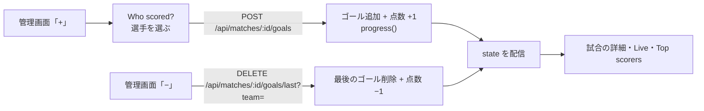

# 設計書: 得点者の記録（Best 8 から）

- **文書バージョン**: 1.0.0（確定・実装済み）
- **作成日**: 2026-11-07
- **関連文書**: `docs/得点者_仕様書.md`（何を作るか）

---

## 1. 方針

- ゴールは試合（`matches`）とは別のテーブルに1件ずつ保存する。
- QF・SF・決勝では、**点数はゴールの件数と同じ**にする。点の増減はゴールの追加・削除でだけ行い、同じトランザクションで `homeScore`・`awayScore` も変える。
- ゴールは `TournamentState.goals` に入れて WebSocket で配信する。画面は届いた state を表示するだけ。



## 2. データ

```sql
CREATE TABLE IF NOT EXISTS match_goals (
  id TEXT PRIMARY KEY,
  match_id TEXT NOT NULL,
  team_id TEXT NOT NULL,        -- 試合運営用チームID
  member_id TEXT,               -- registration_members.id（Unknown player は NULL）
  player_name TEXT,             -- 記録したときの名前（Unknown は NULL）
  back_number INTEGER,          -- 記録したときの背番号
  minute INTEGER NOT NULL,      -- タイマーの分（切り上げ）
  created_at TEXT NOT NULL
);
```

```ts
interface Goal {
  id: string;
  matchId: string;
  teamId: string;
  memberId: string | null;
  playerName: string | null;
  backNumber: number | null;
  minute: number;
  createdAt: string;
}
// TournamentState に goals?: Goal[] を追加
```

- 選手の一覧: チームの `registrationTeamId` から `registration_members` を引く（`RegistrationStore.listPlayers`）。公開の `GET /api/registration/teams` にもう名前と背番号があるが、ID が無いので、管理画面用に `GET /api/matches/:id/players` を作る（ホーム・アウェイの選手 `{id, name, backNumber}`）。
- `writeAll`（`PUT /api/matches`）では、試合が無くなった・未開始に戻った・チームが変わったゴールを消す。`reset`・`generateSchedule` は全部消す。
- TBD のチームにはゴールを入れられない（`INVALID_PLAYER`）。

## 3. API

| メソッド | パス | 権限 | 用途 |
|---|---|---|---|
| `GET` | `/api/matches/:id/players` | 全 Admin（SubAdmin は担当コート） | 両チームの登録選手 |
| `POST` | `/api/matches/:id/goals` | 同上 | `{ teamId, memberId \| null }`。ゴール追加・点数 +1 |
| `DELETE` | `/api/matches/:id/goals/last?team=<teamId>` | 同上 | そのチームの最後のゴールを削除・点数 −1 |
| `PATCH` | `/api/goals/:goalId` | 同上 | `{ memberId \| null }`。得点者を変える（点数は変わらない） |

チェック:

| チェック | エラー |
|---|---|
| 試合が QF・SF・決勝でない | `400 GOALS_NOT_TRACKED` |
| 試合が未開始（SCHEDULED） | `400 MATCH_NOT_STARTED` |
| `teamId` がその試合のチームでない、`memberId` がそのチームの選手でない | `400 INVALID_PLAYER` |
| 点数が変わる操作で、次の試合がもう始まっている | `409 RESULT_LOCKED`（今と同じ判定） |
| 消すゴールがない | `400 NO_GOAL` |
| QF・SF・決勝の点数を `PATCH /api/matches/:id` で直接変える | `400 FIELD_NOT_PATCHABLE`（ゴールの API を使う） |

## 4. サーバー（`worker/store.ts`）

| 処理 | 変更 |
|---|---|
| `addGoal`・`removeLastGoal`・`changeGoalPlayer`（新規） | 上のチェック → `match_goals` と `matches` を同じトランザクションで保存 → `withProgress` → version +1 → 配信 |
| `reset`・`initialize`・`replaceTeamsAndSchedule` | `DELETE FROM match_goals` |
| `snapshot` | `goals` を入れる |

## 5. 画面

| ファイル | 変更 |
|---|---|
| `src/features/admin/components/ScorerPicker.tsx`（新規） | 「Who scored?」のダイアログ。選手・Unknown player・Cancel |
| `src/features/admin/components/GoalList.tsx`（新規） | 管理画面のゴール一覧と「Change」 |
| `src/pages/AdminSetup.tsx` | QF・SF・決勝のとき、「+」でダイアログ、「−」で最後のゴール削除 |
| `src/features/tournament/goals.ts`（新規） | `goalsOf(matchId)`、`topScorers(goals)`（QF 以降だけ、同じ数は同じ順位、Unknown は除く） |
| `MatchCard.tsx`（`showScorers`）、`src/pages/MatchDetail.tsx`、`src/pages/Live.tsx` | 得点者を出す（ゴールは `GoalsContext`・`useGoals()` で配る） |
| `src/pages/Bracket.tsx` | 下に「Top scorers」 |
| `src/i18n/messages.ts` | 英語・ミャンマー語 |

## 6. テスト

| ファイル | 内容 |
|---|---|
| `goals.test.ts` | ランキングの数え方、同じ数は同じ順位、Unknown を除く |
| `worker/api.test.ts` | 追加・削除・変更、権限（担当外コートは 403）、QF 以外は 400、未開始は 400、`RESULT_LOCKED`、点数とゴール数が合う、Reset で消える |
| 手動（ブラウザー） | iPad で「+」→ 選手選択 → Live・試合の詳細・Top scorers に出る |

## 7. リスク

| リスク | 対策 |
|---|---|
| 試合中に選手を選ぶのが遅くて、入力が遅れる | 選手は大きいボタンで背番号の順。「Unknown player」で先に点だけ入れて、あとで「Change」で直せる |
| 登録選手がいないチーム（サンプルデータなど） | 「Unknown player」だけ出す |
| 登録の選手名があとで変わる | 記録したときの名前と背番号を保存する |
