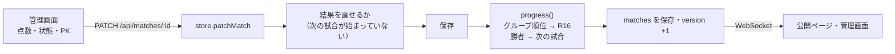

# 設計書: 試合の進行（全試合の操作・決勝トーナメントへの自動進出・PK戦）

- **文書バージョン**: 1.0.0（確定・実装済み）
- **作成日**: 2026-11-07
- **関連文書**: `docs/試合進行_仕様書.md`（何を作るか）

---

## 1. 方針

- 順位と進出の計算は、**React を使わない純粋な関数**にして、画面とサーバー（Worker）の両方で同じものを使う（`src/features/tournament/progression.ts`）。
- 進出はサーバーで行う。試合を変えるたびに、Durable Object の中で計算して保存し、WebSocket で配信する。画面は届いた state を表示するだけ。



## 2. 順位（`progression.ts`）

```ts
rankGroup(groupId, teams, matches, manualOrder?): {
  rows: Standing[];          // 決まった順番
  complete: boolean;         // そのグループの全試合が FINISHED
  unresolved: string[][];    // 手で決める必要がある同点のチームの組（1〜3位の境目にかかるものだけ）
}
```

1. 今の `calculateStandings` と同じ集計（勝ち点・得失点差・総得点）。
2. 勝ち点・得失点差・総得点が同じチームの組ごとに、その組の中の試合だけで同じ集計をして並べる（直接対決）。
3. それでも同じチームが残り、その組が順位 1〜3 のどれか2つにまたがるとき → `manualOrder` があればその順、なければ `unresolved` に入れる。
4. 公開の Groups 画面（`calculateStandings`）も `rankGroup` を使うように変える。

### 2.1 手で決めた順番の保存

```sql
CREATE TABLE IF NOT EXISTS group_orders (
  group_id TEXT PRIMARY KEY,
  team_ids TEXT NOT NULL,      -- JSON: 決めた順番
  results_key TEXT NOT NULL,   -- 決めたときのグループの結果（試合ID:点数 の並び）
  updated_at TEXT NOT NULL
);
```

- `results_key` が今の結果と違うときは使わない（結果が変わったら決め直し）。
- `TournamentState` に `groupOrders?: Record<string, string[]>`（有効なものだけ）を加えて配信する（公開の順位表も同じ順にするため）。

## 3. 進出（`progression.ts`）

```ts
progress(teams, matches, groupOrders): Match[]
```

- **R16**: 各 R16 試合の `R16_SEEDS`（例: `["A1","H2"]`）を見て、グループが `complete` かつ `unresolved` が空なら順位のチームを入れる。そうでなければ**今の値のまま**（テスト用の Seed で入れたチームを消さないため）。
- **QF・SF・決勝**: `sourceMatchIds` の2試合それぞれの勝者（`winnerOf`）を入れる。決まっていなければ `TBD`。
- **始まっている試合は変えない**（`status !== "SCHEDULED"` または点数が入っている試合のチームはそのまま）。
- 変わった試合だけ新しいオブジェクトにする。何も変わらなければ同じ配列を返す。

```ts
winnerOf(match): string | null
// FINISHED で、点数が多い方。同点なら isPenaltyShootout かつ PK の点数が多い方。決まらなければ null
```

## 4. サーバー（`worker/store.ts`）

| 処理 | 変更 |
|---|---|
| `patchMatch` | 1) 次のチェック 2) 保存 3) `progress` を通して、変わった試合も同じトランザクションで保存 |
| `replaceMatches`・`reset`・`generateSchedule` | 保存の前に `progress` を通す |
| `setGroupOrder(groupId, teamIds)`（新規） | `group_orders` に保存し、`progress` を通す |
| `initialize`・`replaceTeamsAndSchedule` | `group_orders` を全部消す（古い手決めが残らないように） |

`patchMatch` のチェック:

| チェック | エラー |
|---|---|
| 終わった試合の点数・状態・PKを変えるとき、その結果で決まる次の試合（R16・QF・SF・決勝）がもう始まっている | `409 RESULT_LOCKED` |
| 決勝トーナメントの試合を FINISHED にするとき、同点で PK の勝者が決まっていない | `400 PENALTIES_REQUIRED` |
| グループの試合に PK を入れようとした | `400 FIELD_NOT_PATCHABLE` |

「次の試合」の見つけ方: グループの試合 → そのグループの順位が入る R16 の2試合。決勝トーナメントの試合 → `sourceMatchIds` にその試合を含む試合。

## 5. API

| メソッド | パス | 権限 | 用途 |
|---|---|---|---|
| `PATCH` | `/api/matches/:id` | 今と同じ | 今と同じ。4章のチェックと自動進出が加わる |
| `PUT` | `/api/groups/:groupId/order` | Super Admin | 同点の順番を決める。本文 `{ "teamIds": [...] }`（そのグループの全チーム） |
| `PUT` | `/api/matches` | Super Admin | 今と同じ（`progress` を通す） |

## 6. 画面

| ファイル | 変更 |
|---|---|
| `src/features/admin/components/MatchPicker.tsx`（新規） | 全試合の一覧と絞り込み（コート・ステージ・状態）。SubAdmin はコート固定 |
| `src/features/admin/components/PenaltyShootout.tsx`（新規） | 決勝トーナメントの同点の試合で、PK の点数を ＋／− で入れる |
| `src/features/admin/components/TieDecisions.tsx`（新規） | 手で順番を決める必要があるグループを出し、順番を上下ボタンで並べ替えて保存 |
| `src/pages/AdminSetup.tsx` | 今の select を `MatchPicker` に置き換える。「Seed knockout teams」はテスト用として残す（名前に「(for testing)」）。PK が決まっていないと Finish を押せない |
| `src/features/tournament/components/MatchCard.tsx`、`src/pages/Bracket.tsx` | PK があれば「PK 4–3」を出す |
| `src/features/tournament/logic.ts` | `calculateStandings` の中身を `rankGroup` に置き換え。`seedKnockoutTeams` はテスト用として残す（手決めの順番も使う） |
| `src/i18n/messages.ts` | 「PK」の表示の英語・ミャンマー語 |

## 7. テスト

| ファイル | 内容 |
|---|---|
| `progression.test.ts` | 勝ち点・得失点差・総得点・直接対決（2チーム・3チーム）、1〜3位の境目にかかる同点だけ `unresolved`、手で決めた順、グループが終わったら R16 に入る（ほかのグループは待たない）、勝者が QF・SF・決勝に入る、PK の勝者、始まっている試合は変えない、QF 以降は元の試合の結果を戻すと TBD に戻る |
| `worker/api.test.ts`（room `test` を使う） | `RESULT_LOCKED`、`PENALTIES_REQUIRED`、グループの PK は 400、`PUT /api/groups/:id/order` の権限と反映、PATCH のあとの state で R16・QF が埋まる |
| 手動（ブラウザ） | サンプル40チームでグループ戦を全部終わらせ、R16 → 決勝まで進める。PK戦。結果の修正と、次の試合が始まったあとに直せないこと |

## 8. リスク

| リスク | 対策 |
|---|---|
| 間違った結果で次の試合が始まってしまう | 「次の試合が始まったら直せない」と画面で知らせる。直したいときは、次の試合を未開始に戻してから直す |
| 同点の手決めを忘れて Round of 16 が埋まらない | 管理画面の上に、決める必要があるグループを目立つように出す |
| 公開の順位表と進出の順位が違う | 同じ `rankGroup` を使う |
